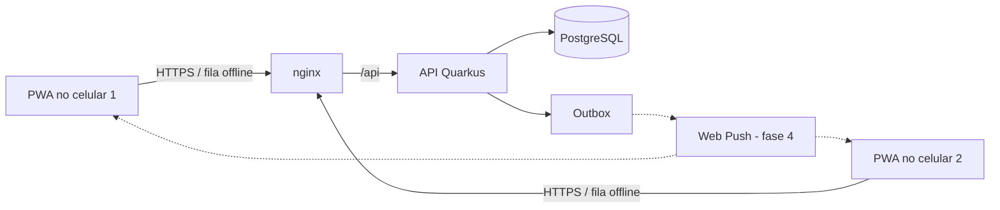

# Remédios

Aplicativo familiar para organizar tratamentos medicamentosos, lembrar horários,
registrar administrações e compartilhar o histórico entre responsáveis —
inclusive offline.

O sistema é um **organizador de informações e lembretes**. Não prescreve, não
calcula nem ajusta doses e não presume que um medicamento foi administrado.

- Especificação completa: [`docs/especificacao.md`](docs/especificacao.md)
- Referência da API: [`docs/api.md`](docs/api.md)
- Decisões provisórias da implementação: [`docs/decisoes.md`](docs/decisoes.md)
- Autenticação com Firebase: [`docs/firebase.md`](docs/firebase.md)
- Aplicativo (PWA) e funcionamento offline: [`docs/pwa.md`](docs/pwa.md)

## Arquitetura

| Camada | Tecnologia | Situação |
| --- | --- | --- |
| Aplicativo | **PWA** — React 19, Vite 8, TypeScript 7, IndexedDB (Dexie), service worker | **telas e offline prontos** |
| API | Java 27, Quarkus 3.40 REST | **Fases 1 a 3 implementadas** |
| Banco central | PostgreSQL 18, migrações Flyway | **esquema completo** |
| Login | Firebase Authentication (Google, e-mail/senha) | **validação na API pronta** |
| Eventos | transactional outbox → push (FCM) / tempo real | outbox gravada; publicador a fazer |



## Roadmap (seção 14 da especificação)

- [x] **Fase 1 — Fundação**
  - [x] esquema PostgreSQL completo (seção 9), com integridade reforçada no banco
  - [x] autenticação com Firebase Authentication e provisionamento da conta local
  - [x] família, membros, papéis e convites
  - [x] cadastro de pessoas (crianças sem conta, adultos com conta)
  - [x] cadastro de tratamentos com versões, revisões, auditoria e outbox
  - [x] padrões da família e preferências pessoais de notificação
- [x] **Fase 2 — Agenda** (API)
  - [x] agenda diária, semanal ou a cada N horas, com fuso e horário de verão
  - [x] geração das doses até o horizonte de 14 dias, recalculando só doses futuras
  - [x] registro de administração, "não foi dada" e correções que preservam o original
  - [x] agenda do período (tela Hoje), detalhe da dose com trilha e histórico com filtros
  - [x] aparelhos da conta (origem de cada registro)
- [x] **Fase 3 — App e offline**
  - [x] PWA instalável com as telas da seção 7 (Hoje, dose, tratamentos, histórico, família, conflitos)
  - [x] login pelo Firebase (Google ou e-mail) e modo local para desenvolvimento
  - [x] app abre sem internet; cópia dos dados no aparelho, sempre sinalizada
  - [x] fila de registros offline com envio idempotente (`operationId`)
  - [x] registros divergentes preservados e conferência humana dos conflitos
- [x] **Saúde** (seção 2.2, antecipado)
  - [x] aferições: temperatura, frequência cardíaca, pressão, saturação, glicemia, peso e outras
  - [x] sintomas e possíveis reações, com início e fim
  - [x] gráfico por tipo com linha de referência da família e doses dadas no mesmo eixo
  - [x] linha do tempo da pessoa (aferições, sintomas e doses), tudo funcionando offline
- [ ] **Fase 4 — Notificações**: lembretes por Web Push, publicador da outbox
- [ ] **Fase 5 — Qualidade e segurança**

## Estrutura

```
compose.yaml              ambiente completo (banco, API, app, testes)
frontend/                 PWA (React + Vite), Dockerfile com nginx
  src/pages/              telas
  src/sync/               fila offline e registro do aparelho
  src/db/                 IndexedDB (cópia offline e fila)
  e2e/                    testes de ponta a ponta (Playwright)
docker/postgres/          inicialização do banco
backend/                  API Quarkus (Dockerfile, mvnw)
  src/main/resources/db/migration/   migrações Flyway (fonte única do esquema)
  src/main/java/.../
    common/      erros da API
    user/        conta local, aparelhos, preferências pessoais
    family/      família, membros, convites, padrões, autorização
    person/      pessoas acompanhadas
    treatment/   tratamentos e revisões
    schedule/    regra de agenda, versões e geração das doses
    occurrence/  doses, administrações, correções, conflitos e histórico
    sync/        operações dos aparelhos e conflitos
    health/      aferições, sintomas e linhas de referência
    audit/       auditoria e outbox
scripts/                  utilitários (token para o modo local)
docs/                     especificação, API, decisões e Firebase
```

## Versões

O projeto usa sempre a versão **estável mais recente** de cada componente, com
versões exatas fixadas. O Dependabot (`.github/dependabot.yml`) propõe as
atualizações toda semana.

| Componente | Versão |
| --- | --- |
| Java (Eclipse Temurin) | 27 |
| Quarkus | 3.40.1.1 |
| PostgreSQL | 18.6 |
| Maven | 3.10.0 (via `./mvnw`) |
| Node.js | 26.12.1 |
| nginx | 1.30.6 |
| React / Vite / TypeScript | 19.3.1 / 8.3.5 / 7.0.2 |

O build recusa JDK anterior ao 27 e Maven anterior ao 3.10 (maven-enforcer).

## Executando com Docker Compose

Todo o ambiente é organizado pelo `compose.yaml` da raiz. Só é preciso ter o
Docker instalado.

```bash
cp .env.example .env               # e preencha FIREBASE_PROJECT_ID

docker compose up -d --build       # app em http://localhost:8000 (API em :8080)
docker compose run --rm tests      # testes de integração do backend
docker compose run --rm e2e        # ponta a ponta do app (exige o modo local, veja docs/pwa.md)
docker compose logs -f api         # acompanhar a API
docker compose down                # parar (use -v para apagar os dados)
```

| Serviço | Imagem | Função |
| --- | --- | --- |
| `postgres` | `postgres:18.6` | bancos `remedios` (API) e `remedios_test` (testes) |
| `api` | build de `backend/Dockerfile` (Temurin 27 JRE) | API REST; health em `/q/health` |
| `web` | build de `frontend/Dockerfile` (nginx 1.30.6) | PWA e proxy de `/api` na mesma origem |
| `e2e` | `mcr.microsoft.com/playwright:v1.64.1-resolute` | Playwright contra o `web` |
| `tests` | `maven:3.10.0-eclipse-temurin-27` | `mvn verify` contra o `postgres` do compose |

O CI do GitHub Actions usa os mesmos comandos.

### Sem Docker

Com JDK 27 e um PostgreSQL 18 local (usuário/senha `remedios`, banco
`remedios_test`):

```bash
cd backend
./mvnw verify        # testes
./mvnw quarkus:dev   # modo desenvolvimento
```

Para outro banco de testes, defina `REMEDIOS_TEST_DB_URL`,
`REMEDIOS_TEST_DB_USER` e `REMEDIOS_TEST_DB_PASSWORD`.

### Autenticação (Firebase)

O login é feito pelo **Firebase Authentication**. O app envia o ID token do
Firebase e a API o valida com as chaves públicas do Google. Basta definir o ID
do projeto no `.env`:

```bash
FIREBASE_PROJECT_ID=meu-projeto-firebase
```

Sem essa variável, a API não sobe. Para desenvolver sem um projeto Firebase,
existe o modo local com tokens gerados por `scripts/token-local.sh`. O passo a
passo completo está em [`docs/firebase.md`](docs/firebase.md).

| Variável | Uso |
| --- | --- |
| `FIREBASE_PROJECT_ID` | ID do projeto Firebase (emissor e audiência dos tokens) |
| `REMEDIOS_DB_URL`, `REMEDIOS_DB_USER`, `REMEDIOS_DB_PASSWORD` | PostgreSQL (definidas pelo compose) |
