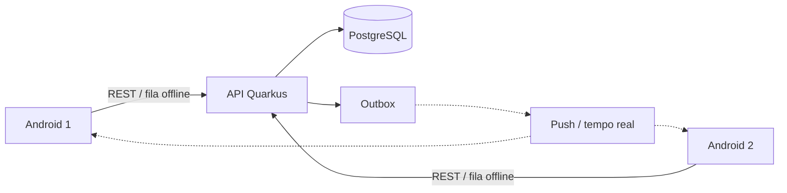

# Remédios

Aplicativo familiar para organizar tratamentos medicamentosos, lembrar horários,
registrar administrações e compartilhar o histórico entre responsáveis —
inclusive offline.

O sistema é um **organizador de informações e lembretes**. Não prescreve, não
calcula nem ajusta doses e não presume que um medicamento foi administrado.

- Especificação completa: [`docs/especificacao.md`](docs/especificacao.md)
- Referência da API: [`docs/api.md`](docs/api.md)
- Decisões provisórias da implementação: [`docs/decisoes.md`](docs/decisoes.md)
- Autenticação com Firebase: [`docs/firebase.md`](docs/firebase.md)

## Arquitetura

| Camada | Tecnologia | Situação |
| --- | --- | --- |
| Aplicativo | Android — Kotlin, Jetpack Compose, Room, WorkManager | a fazer |
| API | Java 27, Quarkus 3.40 REST | **Fase 1 implementada** |
| Banco central | PostgreSQL 18, migrações Flyway | **esquema completo** |
| Login | Firebase Authentication (Google, e-mail/senha) | **validação na API pronta** |
| Eventos | transactional outbox → push (FCM) / tempo real | outbox gravada; publicador a fazer |



## Roadmap (seção 14 da especificação)

- [x] **Fase 1 — Fundação**
  - [x] esquema PostgreSQL completo (seção 9), com integridade reforçada no banco
  - [x] autenticação com Firebase Authentication e provisionamento da conta local
  - [x] família, membros, papéis e convites
  - [x] cadastro de pessoas (crianças sem conta, adultos com conta)
  - [x] cadastro de tratamentos com versões, revisões, auditoria e outbox
  - [x] padrões da família e preferências pessoais de notificação
- [ ] **Fase 2 — Agenda**: recorrência, geração de ocorrências, administração, histórico
- [ ] **Fase 3 — Offline**: Room, fila idempotente, sincronização incremental, conflitos
- [ ] **Fase 4 — Notificações**: lembretes locais, publicador da outbox, push
- [ ] **Fase 5 — Qualidade e segurança**

## Estrutura

```
compose.yaml              ambiente completo (banco, API, testes)
docker/postgres/          inicialização do banco
backend/                  API Quarkus (Dockerfile, mvnw)
  src/main/resources/db/migration/   migrações Flyway (fonte única do esquema)
  src/main/java/.../
    common/      erros da API
    user/        conta local, preferências pessoais
    family/      família, membros, convites, padrões, autorização
    person/      pessoas acompanhadas
    treatment/   tratamentos e revisões
    audit/       auditoria e outbox
scripts/                  utilitários (token para o modo local)
docs/                     especificação, API, decisões e Firebase
```

## Versões

O projeto usa sempre a versão **estável mais recente** de cada componente, com
versões exatas fixadas. O Dependabot (`.github/dependabot.yml`) propõe as
atualizações toda semana.

| Componente | Versão |
| --- | --- |
| Java (Eclipse Temurin) | 27 |
| Quarkus | 3.40.1.1 |
| PostgreSQL | 18.6 |
| Maven | 3.10.0 (via `./mvnw`) |

O build recusa JDK anterior ao 27 e Maven anterior ao 3.10 (maven-enforcer).

## Executando com Docker Compose

Todo o ambiente é organizado pelo `compose.yaml` da raiz. Só é preciso ter o
Docker instalado.

```bash
cp .env.example .env               # e preencha FIREBASE_PROJECT_ID

docker compose up -d --build       # PostgreSQL + API em http://localhost:8080
docker compose run --rm tests      # testes de integração do backend
docker compose logs -f api         # acompanhar a API
docker compose down                # parar (use -v para apagar os dados)
```

| Serviço | Imagem | Função |
| --- | --- | --- |
| `postgres` | `postgres:18.6` | bancos `remedios` (API) e `remedios_test` (testes) |
| `api` | build de `backend/Dockerfile` (Temurin 27 JRE) | API REST; health em `/q/health` |
| `tests` | `maven:3.10.0-eclipse-temurin-27` | `mvn verify` contra o `postgres` do compose |

O CI do GitHub Actions usa os mesmos comandos.

### Sem Docker

Com JDK 27 e um PostgreSQL 18 local (usuário/senha `remedios`, banco
`remedios_test`):

```bash
cd backend
./mvnw verify        # testes
./mvnw quarkus:dev   # modo desenvolvimento
```

Para outro banco de testes, defina `REMEDIOS_TEST_DB_URL`,
`REMEDIOS_TEST_DB_USER` e `REMEDIOS_TEST_DB_PASSWORD`.

### Autenticação (Firebase)

O login é feito pelo **Firebase Authentication**. O app envia o ID token do
Firebase e a API o valida com as chaves públicas do Google. Basta definir o ID
do projeto no `.env`:

```bash
FIREBASE_PROJECT_ID=meu-projeto-firebase
```

Sem essa variável, a API não sobe. Para desenvolver sem um projeto Firebase,
existe o modo local com tokens gerados por `scripts/token-local.sh`. O passo a
passo completo está em [`docs/firebase.md`](docs/firebase.md).

| Variável | Uso |
| --- | --- |
| `FIREBASE_PROJECT_ID` | ID do projeto Firebase (emissor e audiência dos tokens) |
| `REMEDIOS_DB_URL`, `REMEDIOS_DB_USER`, `REMEDIOS_DB_PASSWORD` | PostgreSQL (definidas pelo compose) |
