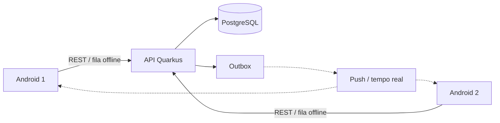

# Remédios

Aplicativo familiar para organizar tratamentos medicamentosos, lembrar horários,
registrar administrações e compartilhar o histórico entre responsáveis —
inclusive offline.

O sistema é um **organizador de informações e lembretes**. Não prescreve, não
calcula nem ajusta doses e não presume que um medicamento foi administrado.

- Especificação completa: [`docs/especificacao.md`](docs/especificacao.md)
- Referência da API: [`docs/api.md`](docs/api.md)
- Decisões provisórias da implementação: [`docs/decisoes.md`](docs/decisoes.md)

## Arquitetura

| Camada | Tecnologia | Situação |
| --- | --- | --- |
| Aplicativo | Android — Kotlin, Jetpack Compose, Room, WorkManager | a fazer |
| API | Java 21, Quarkus REST | **Fase 1 implementada** |
| Banco central | PostgreSQL 16, migrações Flyway | **esquema completo** |
| Eventos | transactional outbox → push (FCM) / tempo real | outbox gravada; publicador a fazer |



## Roadmap (seção 14 da especificação)

- [x] **Fase 1 — Fundação**
  - [x] esquema PostgreSQL completo (seção 9), com integridade reforçada no banco
  - [x] autenticação por JWT e provisionamento da conta local
  - [x] família, membros, papéis e convites
  - [x] cadastro de pessoas (crianças sem conta, adultos com conta)
  - [x] cadastro de tratamentos com versões, revisões, auditoria e outbox
  - [x] padrões da família e preferências pessoais de notificação
- [ ] **Fase 2 — Agenda**: recorrência, geração de ocorrências, administração, histórico
- [ ] **Fase 3 — Offline**: Room, fila idempotente, sincronização incremental, conflitos
- [ ] **Fase 4 — Notificações**: lembretes locais, publicador da outbox, push
- [ ] **Fase 5 — Qualidade e segurança**

## Estrutura

```
backend/                  API Quarkus
  src/main/resources/db/migration/   migrações Flyway (fonte única do esquema)
  src/main/java/.../
    common/      erros da API
    user/        conta local, preferências pessoais
    family/      família, membros, convites, padrões, autorização
    person/      pessoas acompanhadas
    treatment/   tratamentos e revisões
    audit/       auditoria e outbox
docs/                     especificação, API e decisões
```

## Executando o backend

Requisitos: JDK 21, Maven 3.9 e PostgreSQL 16 (local ou via Docker).

```bash
# Banco para testes (ou use um PostgreSQL já instalado com o mesmo usuário/banco)
docker compose up -d

cd backend
mvn test          # testes de integração contra o PostgreSQL
mvn quarkus:dev   # modo desenvolvimento (Dev Services sobe um PostgreSQL via Docker)
```

Os testes usam `jdbc:postgresql://localhost:5432/remedios_test` (usuário e
senha `remedios`). Para outro banco, defina `REMEDIOS_TEST_DB_URL`,
`REMEDIOS_TEST_DB_USER` e `REMEDIOS_TEST_DB_PASSWORD`.

### Autenticação

A API aceita JWT assinado (RS256) de qualquer provedor OIDC; a claim `sub`
identifica a conta. Em produção configure:

| Variável | Uso |
| --- | --- |
| `REMEDIOS_JWT_ISSUER` | emissor esperado (`iss`) |
| `REMEDIOS_JWT_PUBLICKEY_LOCATION` | chave pública ou URL do JWKS do provedor |
| `REMEDIOS_DB_URL`, `REMEDIOS_DB_USER`, `REMEDIOS_DB_PASSWORD` | PostgreSQL |

No modo dev e nos testes é usada a chave de **teste** em
`backend/src/test/resources` — ela nunca deve ser usada em produção.
