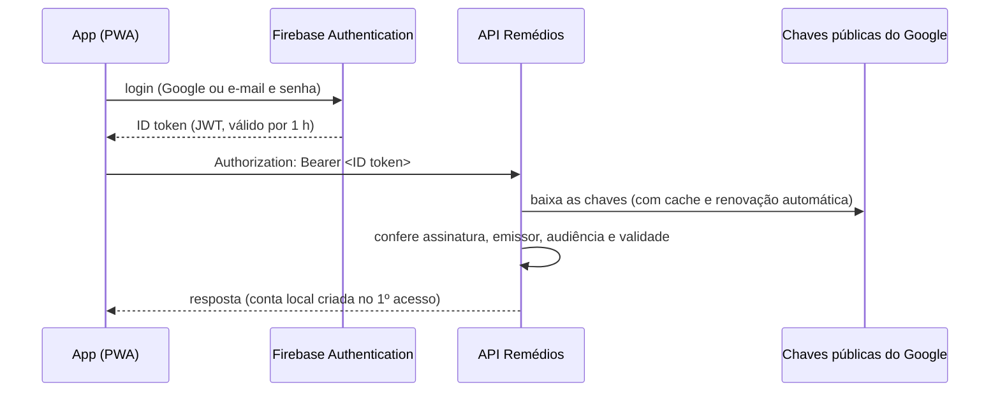

# Firebase Authentication

O login fica a cargo do **Firebase Authentication** (Google). O app (PWA)
faz o login no Firebase e envia à API o **ID token** recebido. A API não
guarda senhas: ela apenas confere o token.



## O que a API verifica

| Verificação | Valor esperado |
| --- | --- |
| Assinatura | RS256, com as chaves de `securetoken@system.gserviceaccount.com` |
| Emissor (`iss`) | `https://securetoken.google.com/<FIREBASE_PROJECT_ID>` |
| Audiência (`aud`) | `<FIREBASE_PROJECT_ID>` |
| Validade (`exp`, `iat`) | dentro do prazo |
| Usuário (`sub`) | UID do Firebase → `app_user.auth_subject` |

Tokens de outro projeto Firebase, vencidos ou com assinatura inválida recebem
`401`. Em produção, a API **não sobe** sem `FIREBASE_PROJECT_ID`.

O nome inicial da conta vem da claim `name`, ou de `email`, e pode ser alterado
em `PUT /api/me`.

## Configurando o projeto no Firebase

1. Acesse <https://console.firebase.google.com> e crie um projeto (por exemplo,
   `remedios-familia`). O Google Analytics é opcional.
2. Em **Authentication → Método de login**, ative os provedores desejados:
   - **Google**: o mais simples para a família;
   - **E-mail/senha**: para quem não quer usar conta Google.
3. Em **Configurações do projeto → Geral**, copie o **ID do projeto**.
4. Coloque-o no `.env` da raiz:

   ```bash
   FIREBASE_PROJECT_ID=remedios-familia
   ```

5. Suba o ambiente: `docker compose up -d --build`. O log da API mostra
   `Autenticação via Firebase: emissor …, audiência remedios-familia`.

A API não precisa de credencial de serviço nem de arquivo JSON do Firebase:
as chaves usadas na verificação são públicas.

## No app (PWA)

1. No console, em **Configurações do projeto → Seus apps**, adicione um app
   **Web** (`</>`). Copie `apiKey`, `authDomain` e `appId` para o `.env`:

   ```bash
   VITE_FIREBASE_API_KEY=...
   VITE_FIREBASE_AUTH_DOMAIN=remedios-familia.firebaseapp.com
   VITE_FIREBASE_APP_ID=...
   ```

   Esses valores identificam o projeto para o navegador e não são segredos. O
   `projectId` vem do próprio `FIREBASE_PROJECT_ID`.
2. Em **Authentication → Configurações → Domínios autorizados**, inclua o
   domínio onde o app será publicado (e `localhost` para testes).
3. Rode `docker compose up -d --build`. O serviço `web` embute essa configuração
   no build do PWA.

O SDK do Firebase renova o token sozinho antes de vencer, e o app envia o token
em cada chamada à API.

## Desenvolvimento sem Firebase

Para usar a API localmente sem um projeto real, há o **modo local**. A API
aceita tokens no formato do Firebase assinados com a chave de **teste** do
repositório.

```bash
# .env
FIREBASE_PROJECT_ID=remedios-local
REMEDIOS_JWT_PUBLICKEY_LOCATION=/run/keys/test-public.pem
```

```bash
docker compose up -d --build
# Para a API direto (curl); no app, use também VITE_AUTH_MODE=local (docs/pwa.md).
TOKEN=$(scripts/token-local.sh ana "Ana")
curl -H "Authorization: Bearer $TOKEN" http://localhost:8080/api/me
```

Nesse modo, a API registra um aviso no log ao subir. **Nunca use em produção:**
a chave privada de teste está no repositório, e qualquer pessoa poderia gerar
tokens. Os testes automatizados e o CI usam esse mesmo formato de token.

## Limitações conhecidas

- **Revogação:** um ID token continua válido até expirar (no máximo 1 hora),
  mesmo depois de a sessão ser revogada no Firebase. Detectar a revogação na
  hora exige a Admin SDK com credencial de serviço. A remoção de um membro da
  família, porém, vale imediatamente, porque o acesso à família é conferido no
  banco a cada requisição. A revogação de dispositivos (seção 12) fica para a
  Fase 5.
- **Privacidade (LGPD):** o Google processa apenas os dados de identidade
  (nome, e-mail, foto). Dados de saúde (pessoas, tratamentos, doses) ficam só
  no nosso PostgreSQL.
