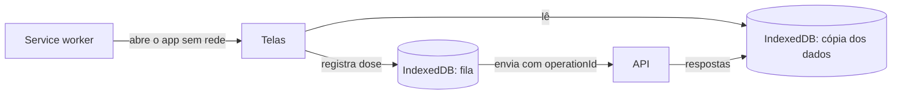

# Aplicativo (PWA)

O aplicativo é um **PWA** (Progressive Web App): roda no navegador e pode ser
instalado na tela inicial do Android, do iPhone ou do computador. Fica em
`frontend/` e é feito com React, Vite e TypeScript.

## Telas (seção 7 da especificação)

| Tela | Rota | O que faz |
| --- | --- | --- |
| Hoje | `/` | doses do dia por pessoa, estado de sincronização, atalho para registrar |
| Dose | `/doses/:id` | conferir e registrar administração ou "não foi dada", corrigir, revisar conflitos, trilha |
| Tratamentos | `/tratamentos` | lista por pessoa e situação; cadastro e alteração com editor de agenda e conferência |
| Histórico | `/historico` | filtros por pessoa, tratamento, período e responsável |
| Família | `/familia` | membros e convites, pessoas, padrões da família, preferências, aparelhos, conta |
| Para conferir | `/conflitos` | doses com registros divergentes |

| Hoje | Dose | Offline | Conferência |
| --- | --- | --- | --- |
|  |  |  |  |

As capturas são geradas pelo teste de ponta a ponta (`E2E_SCREENSHOTS=pasta npm run e2e`).

## Funcionamento offline



- **O app abre sem internet.** O service worker guarda o código do app, e as
  telas mostram a última cópia dos dados guardada no aparelho (IndexedDB),
  sempre com o aviso "Offline · dados de há N min".
- **Doses registradas sem internet** vão para uma fila no aparelho, aparecem
  como "Aguardando envio" e são enviadas assim que a conexão volta: ao
  reconectar, ao reabrir o app e a cada 30 segundos.
- **Reenviar é seguro.** Cada registro tem um `operationId` gerado no aparelho;
  o servidor reconhece reenvios e não repete os efeitos (seção 10.1).
- **Registros divergentes são preservados.** Se outra pessoa registrou a mesma
  dose enquanto o aparelho estava offline, nada é descartado: a dose vai para
  "Conferir" e um responsável decide (seção 10.3).
- **O app nunca mostra "Sincronizado"** enquanto houver registro sem
  confirmação do servidor. Um registro recusado (por exemplo, a dose de outro
  dia) fica visível em Hoje até o responsável tentar de novo ou descartar.
- **Precisam de conexão:** login, cadastro e alteração de tratamentos, pessoas
  e família, correções e conferência de conflitos. Esses passos dependem da
  versão mais recente dos dados.

## Instalar no celular

- **Android (Chrome):** abra o endereço do app e toque em **Instalar app**, ou
  em ⋮ → **Adicionar à tela inicial**.
- **iPhone (Safari):** toque em **Compartilhar** → **Adicionar à Tela de
  Início**. No iPhone, as notificações (fase 4) só funcionam com o app
  instalado.

Em produção, o app precisa de **HTTPS**: o service worker só funciona em
origem segura (ou em `localhost`).

## Desenvolvimento

```bash
cd frontend
npm ci
npm run dev        # http://localhost:5173, com /api repassado para :8080
npm test           # testes unitários (Vitest)
npm run typecheck
npm run e2e        # ponta a ponta (Playwright), veja abaixo
```

### Modo local (sem Firebase)

Com `VITE_AUTH_MODE=local`, a tela de login pede só um nome e gera tokens no
formato do Firebase, assinados com a chave de **teste** do repositório. A API
precisa estar no modo local (veja [`firebase.md`](firebase.md)).

```bash
# .env da raiz
FIREBASE_PROJECT_ID=remedios-local
REMEDIOS_JWT_PUBLICKEY_LOCATION=/run/keys/test-public.pem
VITE_AUTH_MODE=local

docker compose up -d --build       # app em http://localhost:8000
```

O código do modo local só entra no pacote quando `VITE_AUTH_MODE=local`. O CI
confere que o build de produção não contém a chave.

### Testes de ponta a ponta

`e2e/fluxo.spec.ts` simula dois responsáveis em celulares:

1. cadastro da família, da pessoa e do tratamento com agenda;
2. registro online;
3. convite para o segundo responsável;
4. o app aberto sem rede;
5. registro offline;
6. a mesma dose registrada pelo outro responsável;
7. a volta da conexão, com a dose indo para conferência;
8. a decisão humana sobre o conflito.

```bash
docker compose run --rm e2e        # com o compose no modo local (acima)
```

## Lembretes

Um PWA não consegue agendar notificações no próprio aparelho. Os lembretes
virão por **notificação push** enviada pelo servidor (fase 4), por isso
dependem de o celular ter internet na hora da dose. Os outros avisos
(conflitos, registros importantes) já dependem do servidor de qualquer forma.
Se lembrar sem internet se mostrar indispensável, o mesmo código pode ser
empacotado como app nativo (Capacitor) com notificações locais.
