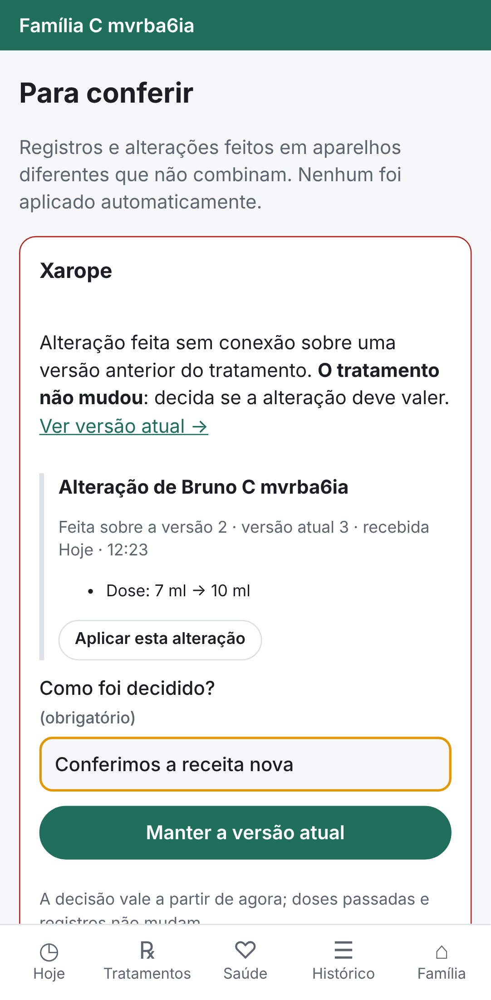

# Qualidade (fase 5)

O que a seção 14 da especificação pede para a fase 5 e onde cada item é
verificado. Todos os testes automáticos rodam no CI a cada mudança.

| Item | Como é verificado |
| --- | --- |
| Concorrência | `ConcurrencyTest`: rajadas de 8 pedidos liberados no mesmo instante (veja abaixo) |
| Aparelhos offline | e2e `offline.spec.ts`, `conflito-tratamento.spec.ts`, `fluxo.spec.ts` e `saude.spec.ts`; unitários da fila (`outbox.test.ts`, `mutations.test.ts`) |
| Restauração de backup | `scripts/restore-test.sh` no CI, com os dados criados pelo e2e ([`operacao.md`](operacao.md)) |
| Privacidade e segurança | `SecurityTest` (matriz de autorização de todas as rotas), `ExportTest`, cabeçalhos e política de conteúdo no e2e `qualidade.spec.ts`, `npm audit` no CI ([`seguranca.md`](seguranca.md)) |
| Acessibilidade e usabilidade | e2e `qualidade.spec.ts`: axe com as regras WCAG 2.1 A/AA e 2.2 AA em 15 telas, nos temas claro e escuro, mais o foco visível pelo teclado |

## Concorrência

Cada teste dispara 8 pedidos ao mesmo tempo, liberados juntos por uma
barreira:

- **Mesma dose registrada por várias pessoas online:** uma administração
  aceita; as outras recebem `409` com quem registrou.
- **Mesma dose registrada offline em vários aparelhos:** nenhuma proposta é
  perdida. Uma administração vale, a dose vai para conferência, e há um único
  conflito com as outras 7 propostas.
- **Mesma chave de operação reenviada em rajada:** o efeito acontece uma vez.
  Os pedidos que chegam durante a execução recebem `409
  OPERATION_IN_PROGRESS`, e a fila tenta de novo.
- **Mesmo tratamento alterado por várias pessoas:** uma alteração vale; as
  outras recebem `409 STALE_VERSION`.
- **Mesmo tratamento alterado offline em vários aparelhos:** as 8 propostas
  ficam no mesmo conflito, e o tratamento não muda.

## Aparelhos offline

- `offline.spec.ts`: sem conexão, cadastra uma pessoa e um tratamento para
  ela, e ativa o tratamento informando as doses anteriores. Com a conexão de
  volta, confere que tudo chega na ordem.
- `conflito-tratamento.spec.ts`: dois aparelhos sem conexão alteram a mesma
  dose do tratamento. A primeira alteração a chegar vale; a segunda vai para
  "Para conferir", e outro responsável a aplica com motivo.
  
- `fluxo.spec.ts`: registro offline e conflito de dose entre dois
  responsáveis.

## Acessibilidade

O e2e `qualidade.spec.ts` passa pelas telas com dados reais:

- entrar, começar, Família;
- novo tratamento, conferência, pergunta das doses anteriores, tratamento,
  tratamentos;
- Hoje, dose;
- Saúde, nova aferição, novo sintoma;
- histórico, "Para conferir".

Em cada tela, roda o axe com as regras WCAG 2.1 A/AA e 2.2 AA, que incluem o
tamanho mínimo dos alvos de toque. Hoje, Tratamentos, Saúde e Família são
conferidos de novo no tema escuro. O teste também confere que o foco do
teclado tem contorno visível.

### O que falta conferir com pessoas

A verificação automática não substitui:

- **Leitor de tela no celular:** TalkBack (Android) e VoiceOver (iPhone) no
  fluxo de registrar uma dose e no da conferência.
- **Teste de uso com responsáveis de verdade:** registrar a dose da madrugada
  com sono, uma mão ocupada, pouca luz e com outra pessoa também cuidando.
  Medir o tempo até registrar e os erros (dose errada, pessoa errada).
- **Fonte grande:** o app usa unidades relativas; vale conferir com o maior
  tamanho de fonte do sistema.
